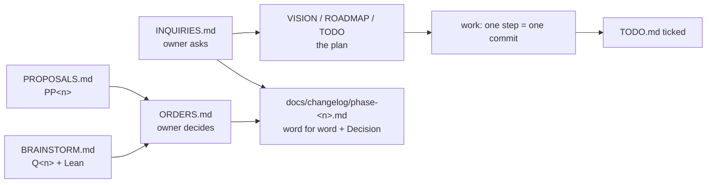

# devlog

The talk between the owner and the agents, and the plan it produces. The
standard look of a BOS project's `docs/devlog/`, the same as in the BOS core
(`blacksmith-organization-system/docs/devlog/`) and in Amoorion.

| File | What it holds | Who writes it |
| ---- | ------------- | ------------- |
| `VISION.md` | why the project exists, its principles, the idea of each phase | agents, from the owner's words |
| `ROADMAP.md` | milestones and phases on the version scale | agents, from the owner's words |
| `TODO.md` | the checklist: `## Phase <n>: <title>`, then `- [ ]` / `- [x]` items | agents tick items in the commit that finishes them |
| `BRAINSTORM.md` | open questions `## Q<n>. <title>`, each with a *Lean:* | agents ask, the owner decides |
| `PROPOSALS.md` | ideas for debate `PP<n>` | anyone proposes, the owner decides in ORDERS.md |
| `ORDERS.md` | the owner's decisions: answers to `Q<n>` and to `PP<n>`, below its `---` | **owner**; agents empty it |
| `INQUIRIES.md` | the owner's requests in their own words, below its `---` | **owner**; agents empty it |
| `STATE.md` | where the project stands; made by `task devlog:state` (the `bos` command of the core), not kept in git | the core |
| `Taskfile.yml` | `scrapnote`, `state` | agents |
| `scrapnote-<UNIXUSAT>.md` | notes of a working round, not sorted yet | anyone |
| `AGENTS.md` | imports this README for agents | |

## How a batch moves

1. The owner answers questions and decides proposals below `---` in ORDERS.md and asks below `---` in
   INQUIRIES.md (or in the chat; the words are then copied from there).
2. An agent first turns an inquiry into the plan (VISION, ROADMAP, TODO).
3. The owner's words move **word for word** into the append-only
   `docs/changelog/phase-<n>.md`, answered questions and decided
   proposals with their **Decision:**; ORDERS.md and INQUIRIES.md go back to their header, and the
   answered `Q<n>` leave BRAINSTORM.md, the decided `PP<n>` PROPOSALS.md.
4. Then the work, one step per commit on the agent's `dev/<name>`, each
   ticking its TODO item.

## Where else it is shown (phase 28)

The markdown here is the source; two places show it and are made from it:

- **GitHub**: a milestone per milestone of ROADMAP, an issue per phase (its
  items a task list, closed when all are ticked), per `Q<n>` and per `PP<n>`
  (closed once answered or decided, with the owner's words), all on the
  board "P_JOL_ROLL devlog". `task github:devlog` brings them there; the
  workflow `devlog.yml` does it on each push of the devlog to `development`,
  but the board, which is the owner's.
- **The wiki**: a copy of this devlog and of the almanac, `task docs:wiki`
  (the submodule `docs/wiki`). The website of the documentation links there
  instead of publishing them.

- **The discussion of announcements** (#107, phase 29): the workflows say
  there what happened - the steps ticked on `development` with the phases
  and milestones they finished (`devlog.yml`), a phase closed on its way to
  `master` (`phase-close`), a release and how each of its jobs ended
  (`release.yml`). `scripts/devops/github/announce.py`; `task
  github:announce -- --dry ...` shows a comment without posting it.

An issue or a wiki page changed by hand is overwritten by the next run:
answer in ORDERS.md, ask in INQUIRIES.md.

Numbers `Q<n>` and `PP<n>` are given once and never reused. A question never
gets settled in code before the owner answers it. Agents' own findings go to
`docs/.agents/`, not here. The two scrapnotes of October 2026 stay here as they
were written.
