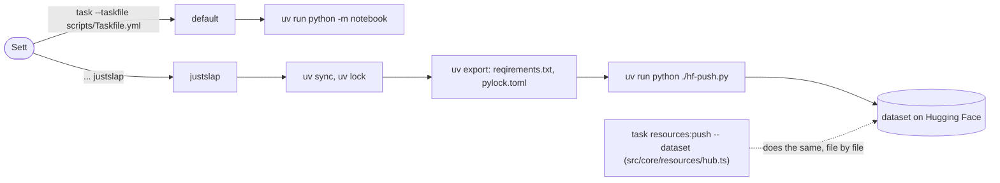

# P_JOL_ROLL - additional scripts and tools

Things that stand beside the code, not in it: setting up a machine, and the
first Python way of sending the dataset. Nothing here gathers, and nothing
here is run by tests or by other tasks.

## Toys used here

| Toy | For |
| --- | --- |
| `sh` and `cmd` | setting up a machine, Linux and Windows |
| apt, [n](https://github.com/tj/n), [get.docker.com](https://get.docker.com), the [uv installer](https://docs.astral.sh/uv/) | what `install.sh` takes on Debian and Ubuntu |
| [winget](https://learn.microsoft.com/windows/package-manager/winget/) | what `install.bat` takes on Windows |
| [uv](https://docs.astral.sh/uv/) and [huggingface_hub](https://huggingface.co/docs/huggingface_hub/) | the Python push of the dataset |
| [Task](https://taskfile.dev) | `Taskfile.yml` here, run on its own |

## How the tasks here are used

`scripts/Taskfile.yml` is not included in the root one. It is run from this
directory, and it runs Python of the dataset with `uv`.

## Every file

| File | Path | What, why and where |
| --- | --- | --- |
| `install.sh` | `scripts/install.sh` | Sets up a Debian or Ubuntu machine: Docker, Node with `n` on version 24, newest npm, Python with pip and venv, uv. Takes only what is missing and asks sudo for apt. Read it before running: `sh scripts/install.sh`. |
| `install.bat` | `scripts/install.bat` | The same on Windows with winget: Docker Desktop, Node LTS, npm, Python with pip, uv. `n` does not run on Windows, so winget keeps Node instead. |
| `Taskfile.yml` | `scripts/Taskfile.yml` | Two tasks: `default` opens a notebook, `justslap` locks Python packages and pushes the dataset by `hf-push.py`. Sett's experiment with time measurement, kept. |
| `hf-push.py` | `scripts/hf-push.py` | First way of sending: logs in and sends the whole `resources/dataset` with `upload_folder`. Kept beside `task resources:push`, which sends only files that differ. |
| `README.md` | `scripts/README.md` | This page. |
