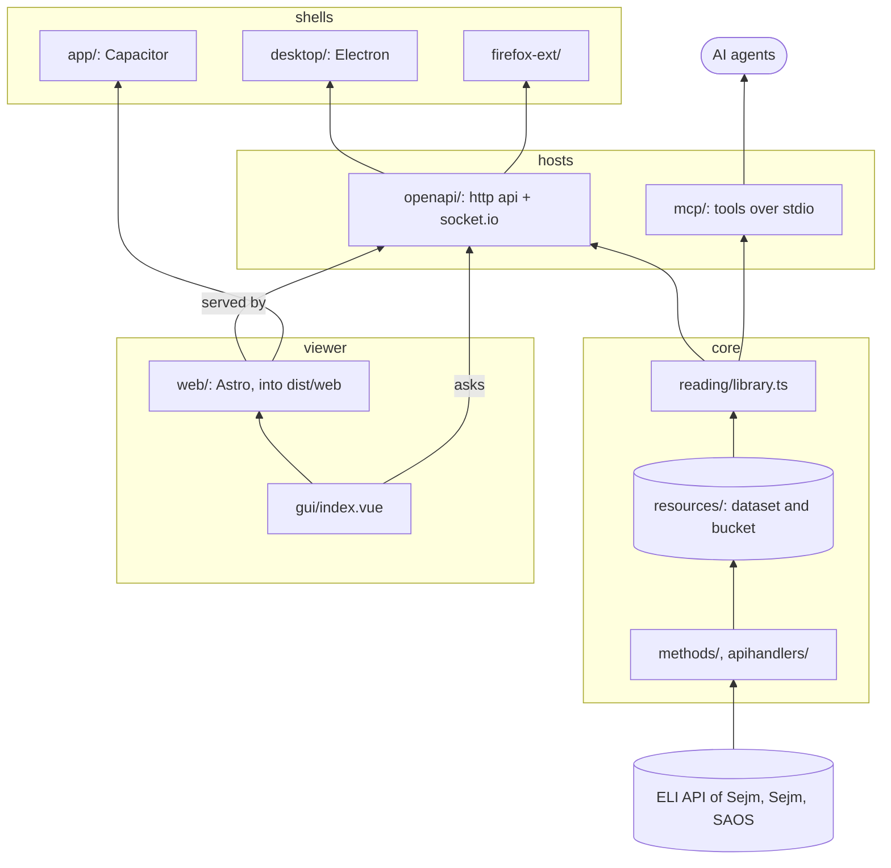
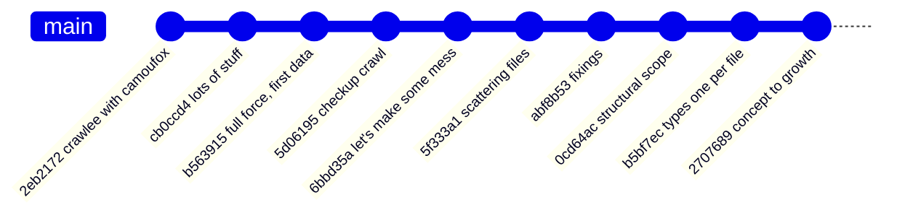

# P_JOL_ROLL - source codes explanations

Everything that runs. One core gathers and reads the journals of laws; every
other directory is a way in to what the core gathered: an api, a server for
AI agents, a website, a window, an android app, a browser extension. None of
them asks the source; only the core does, and only when a person starts it.

## Toys used here

| Toy | For |
| --- | --- |
| [TypeScript](https://www.typescriptlang.org/), run by [tsx](https://tsx.is/) | core, api, MCP server |
| [Crawlee](https://crawlee.dev/) | polite walks over the APIs (`HttpCrawler`) and websites (`PlaywrightCrawler` with Camoufox) |
| [turndown](https://github.com/mixmark-io/turndown) | HTML of acts into markdown |
| [@huggingface/hub](https://huggingface.co/docs/huggingface.js/hub/README) | sync of `resources/` with Hugging Face |
| [Express](https://expressjs.com/) and [socket.io](https://socket.io/) | the http api and its live notices |
| [MCP TypeScript SDK](https://github.com/modelcontextprotocol/typescript-sdk) (`@modelcontextprotocol/server`) and [zod](https://zod.dev/) | tools for AI agents |
| [Vue](https://vuejs.org/) and [marked](https://marked.js.org/) | the viewer, shared by every interface |
| [Astro](https://astro.build/) with `@astrojs/vue` | the website, built into static files |
| [Electron](https://www.electronjs.org/) | the desktop window |
| [Capacitor](https://capacitorjs.com/) | the android app (configured, not set up yet) |
| WebExtensions, manifest v3 | the browser extension, Firefox and Chrome |
| [Workflow SDK](https://workflow-sdk.dev/) on [Nitro](https://nitro.build/) 3 (beta) | durable runs: steps that survive restarts, retries, waiting for a person |

## Four major parts

The directories group into four parts. Each part only leans on the one below it.

| Part | Directories | What it is |
| --- | --- | --- |
| **core** | `core/` | gathering, checksums, tables, markdown, and reading of all of it |
| **hosts** | `openapi/`, `mcp/`, `workflows/` | serve what the core reads: to programs over http, to AI agents over stdio; and run the core's commands as durable runs |
| **viewer** | `gui/`, `web/` | one Vue viewer, and the website that carries it |
| **shells** | `desktop/`, `app/`, `firefox-ext/`, `chrome-ext/` | wrap the viewer or the api for one kind of device |

## How the code grew

All on `master`, each commit written by Sett Sarverott; only the commits
that touched `src/` are shown. `git log --oneline -- src` gives the newest.

## Every file

### core

| File | What, why and where |
| --- | --- |
| `src/core/main.ts` | Command line of the gatherer: reads arguments and calls one command. Usage is written at its top. Run by `task gather`, `seal`, `compile`, `text`, `sejm`, `saos`, `checkup`, `hub`, and by the Docker image. |
| `src/core/crawl.ts` | One polite walk over addresses of an API: own User-Agent, two requests at a time, a pace per minute, queue in memory. Every gatherer uses it, so manners live in one place. |
| `src/core/apihandlers/eli.ts` | Addresses of the ELI API of Sejm and the files of an act (`filesOf`). Where to ask, never what to do. |
| `src/core/apihandlers/sejm.ts` | Second source: legislative processes and prints of Sejm, into `resources/dataset/sejm` and `bucket/sejm`. |
| `src/core/apihandlers/saos.ts` | Third source: court judgments of SAOS by months, into `resources/dataset/SAOS`. |
| `src/core/methods/gather.ts` | The gatherer: index, lists, listings of years, then files of acts year by year; `--since` takes changed acts again. Writes a checksum record for every file the moment it lands. |
| `src/core/methods/seal.ts` | Checksum records for files gathered without them, and `--check` that reads every file again. |
| `src/core/methods/compile.ts` | Tables of the dataset from raw files: details and references of acts, a year in a file. |
| `src/core/methods/checkup.ts` | Browser (Camoufox) visits websites that show acts to people and writes what it saw. |
| `src/core/parsing/text.ts` | Markdown from the HTML of acts, with a record that ties both by checksums; from PDFs too with `--pdf`. |
| `src/core/parsing/pdf.ts` | The text layer of a PDF (pdftotext of poppler) into markdown; scans without a layer named, never guessed. |
| `src/core/parsing/turndown.d.ts` | Types for turndown, which comes without them. |
| `src/core/resources/store.ts` | Where every gathered thing is written and how: `.part` first, then the real name. |
| `src/core/resources/hub.ts` | Comparison and sync of `resources/` with Hugging Face, file by file. |
| `src/core/reading/library.ts` | Gathered data as readers see it: journals, pages of acts, one act, its text, its ties, its files. Only reads `resources/`. The hosts stand on this and nothing else. |
| `src/core/reading/remote.ts` | The remote mode (the demo): with `DATASET_URL` and `BUCKET_URL`, each file a reader needs is taken once from the copies on Hugging Face into `resources/` (a cache then, fresh for `REMOTE_HOURS`); raw files are addresses on the bucket. `library.prepare()` names what each address needs. Never asks the sources of the law. |
| `src/core/vars/interfaces/*.interface.ts` | Every interface, one per file. `index.ts` there groups them into `GatheringScope`, `HuggingfaceScope` and `ReadingScope`. |
| `src/core/vars/types/*.type.ts` | Every type alias, one per file, grouped the same way in its `index.ts`. |

### hosts

| File | What, why and where |
| --- | --- |
| `src/openapi/main.ts` | Starts the http api: `task serve`. `PORT` and `HOST` in environment; by default only this machine can reach it. |
| `src/openapi/server.ts` | Express app, socket.io (sends `journals` on connect and `changed` when files of the dataset change), and the built website from `dist/web`. Open to every origin, because the data is public and the extension and the app ask from elsewhere. |
| `src/openapi/routes.ts` | The read-only routes under `/api`. |
| `src/openapi/spec.ts` | OpenAPI 3.1 description, served at `/openapi.json`. Kept by hand next to the routes. |
| `src/workflows/flows/daily.ts` | The daily run: `gather --since`, `seal`, `compile`, `text`, `hub plan` of each repository, then it waits for an answer (3 days by default). Only "yes" makes it push; no answer ends it without pushing. |
| `src/workflows/flows/steps.ts` | Steps: each runs one command of `src/core/main.ts` in its own process and keeps its last 40 lines. Retried 3 times by the runtime; every command is safe to repeat. |
| `src/workflows/server/api/daily.post.ts` | `POST /api/daily` starts a run and answers with its approval token. `task workflows:daily`. |
| `src/workflows/server/api/daily/approve.post.ts` | `POST /api/daily/approve` answers a waiting run. The server listens on this machine only, which is what makes the answer a person's. `task workflows:approve`. |
| `src/workflows/nitro.config.ts` | Nitro with the `workflow/nitro` module. Built from inside `src/workflows` (`task workflows:build`), because names of workflows are paths from where the build runs. |
| `src/mcp/main.ts` | MCP server over stdio: tools `journals`, `search_acts`, `act`, `act_text`, `act_references`. Read-only, so an agent cannot start a crawl of the source. `task mcp`. |

### viewer

| File | What, why and where |
| --- | --- |
| `src/gui/index.vue` | The one viewer: pick a journal and a year, search titles, open an act, read its markdown, follow its ties, open its PDF. Takes the address of the api as `api`. Every interface shows this. Laid out with Bulma. |
| `src/gui/components/TiesDiagram.vue` | The ties of an act as the mermaid flowchart of the core (`/diagram`), rendered by mermaid (loaded only when needed); a click on a node opens that act. |
| `src/gui/components/LawMap.vue` | The map of the whole law (sigma.js): a preset made by `task map`, a colour per type of act; hovering an act lights its ties, a click opens it. |
| `src/core/methods/map.ts` | `task map`: the acts of a preset and the ties among them placed by ForceAtlas2 once, into `dataset/map/<preset>.json` (compact: nodes `[ELI, title, x, y, size, kind]`, edges `[from, to, tie]`). |
| `src/core/methods/presets.ts` | The presets of the map: statutes in force (2.8 thousand acts), every statute (10 thousand), every act in force (20 thousand); apart from map.ts so readers know them without the layout. |
| `src/core/search/typesense.ts` | Search over every year by Typesense, plain http: `task search:index` fills the collection `acts` from the listings, keywords and (`--texts`) the first 2000 characters of each text; `search()` behind `/api/search`, which answers 503 with the way to start it when it is not there. |
| `src/gui/components/TiesMinimap.vue` | A minimap of the ties in the corner (Cytoscape.js): the act in the middle, a colour per kind of tie, a click opens an act; it can be hidden. |
| `src/core/reading/diagram.ts` | The ties of an act as one mermaid flowchart - the one drawing the api, the MCP server (`act_references` with `as: mermaid`) and the viewer give. |
| `src/web/pages/index.astro` | The website page that carries the viewer. `task web:build` writes `dist/web`, which the api serves. `PUBLIC_API` at build time points it at another host; `PUBLIC_SITE` is its own address for the card of a shared link (the demo by default). |
| `src/web/public/` | Favicons, manifest icons and `og.jpg`, made by `scripts/devops/media/build.sh` from the gist `resources/mediafiles` and committed; the introduction (`webpage/`) takes them too. |
| `astro.config.mjs` (root) | Where Astro finds `src/web` and writes `dist/web`. |

### shells

| File | What, why and where |
| --- | --- |
| `src/desktop/main.js` | Electron window: starts the api for itself on this machine only and shows the viewer. `task desktop`. |
| `src/app/manifest.json` | Web app manifest of the viewer, linked by the website, so it can also be installed from a browser. |
| `src/app/capacitor.config.json` | Capacitor settings of the android app: its web part is `dist/web`. `task app:sync -- add android` the first time. |
| `src/firefox-ext/manifest.json`, `popup.html`, `main.js` | Browser extension: looks up an act cited in the open tab or typed in (`Dz.U. 2026 poz. 1`, ISAP addresses, ELI) in a P_JOL_ROLL host. Loads in Firefox, and unpacked in Chrome. `task extension` says how. |
| `src/chrome-ext/main.js` | Empty, kept by Sett; the Firefox extension loads in Chrome already. |
| `src/tui/index.tsx`, `main.js`, `termui.config.ts`, `termui.config.json` | Sett's experiment with a terminal interface ([TermUI](https://arindam200.github.io/termui) on `ink` and `react`), moved here as it was. Its packages are not in `package.json` yet, so Biome and TypeScript skip this directory until it is wanted. |
| `src/core/logging/setup.ts` | The one logger of every command and of the api: crawlee's own (`@apify/log`), so gathering and everything after it write the same lines. `LOG_FORMAT=json` gives one JSON object a line with the data of the event, `LOG_LEVEL` sets how much (the log mode: error, warn, info, debug, verbose), every run also writes `logs/log-<Date.now()>-<log mode>-<command>.log` (`LOG_DIR`, `off` for none) after the entry point calls `logRun(<command>)`, a crash is logged before the exit, `SYSLOG_ADDRESS=udp://host:port` also sends each line as RFC 5424 syslog (the `log-collector` service listens on `udp://127.0.0.1:5514`). Imported first by `src/core/main.ts` and `src/openapi/main.ts`. |
| `src/tui/launcher/main.ts`, `select.ts` | The launcher, what bare `task` opens: a menu of the ways to run the project - first launch, then every Taskfile as a group of its tasks, then a REPL - moved with ↑/↓ and Enter; a chosen task asks for its arguments and runs. Without a terminal it prints the list instead. Nothing but `node:readline`. |
| `src/cli/tasks.ts`, `repl.ts` | The commands of the launcher: every task read from `task --list-all --json`, grouped by its Taskfile (by namespace for included ones), run by the `task` of `node_modules`; the REPL `p-jol-roll>` takes any task as a command with Tab completion, and `help`, `list [group]`, `menu`, `exit`. |
| `src/devtools/version.ts` | One version for the repository: `sync` writes the version of `package.json` into the lock, the api, the MCP server, the extension and the Python projects; `bump-commit` bumps the patch on `dev/*` branches (pre-commit hook); `merge` is the git merge driver that keeps the higher version. As in the BOS core, without needing `bos`. |
| `src/devtools/init.ts` | `task init`, the first launch on a machine: names the tools found and missing (node 24, npm 11, git needed; docker, uv optional), makes `.env` from `.env.example` when there is none, generates the services' secrets into `resources/secrets/` without overwriting, and leaves `resources/.containerdatavol/init/done` so the task runs once. |
| `src/devtools/merge.ts` | `task resources:merge`: the directories the other sources had before phase 10 (`sejm-dataset`, `sejm-bucket`, `saos-dataset`) moved file by file into `dataset/` and `bucket/`, never over a file that is there; local only. |
| `src/Taskfile.yml` | Tasks of these parts, included in the root one: `serve`, `mcp`, `web:build`, `web:dev`, `desktop`, `app:sync`, `extension`. |
