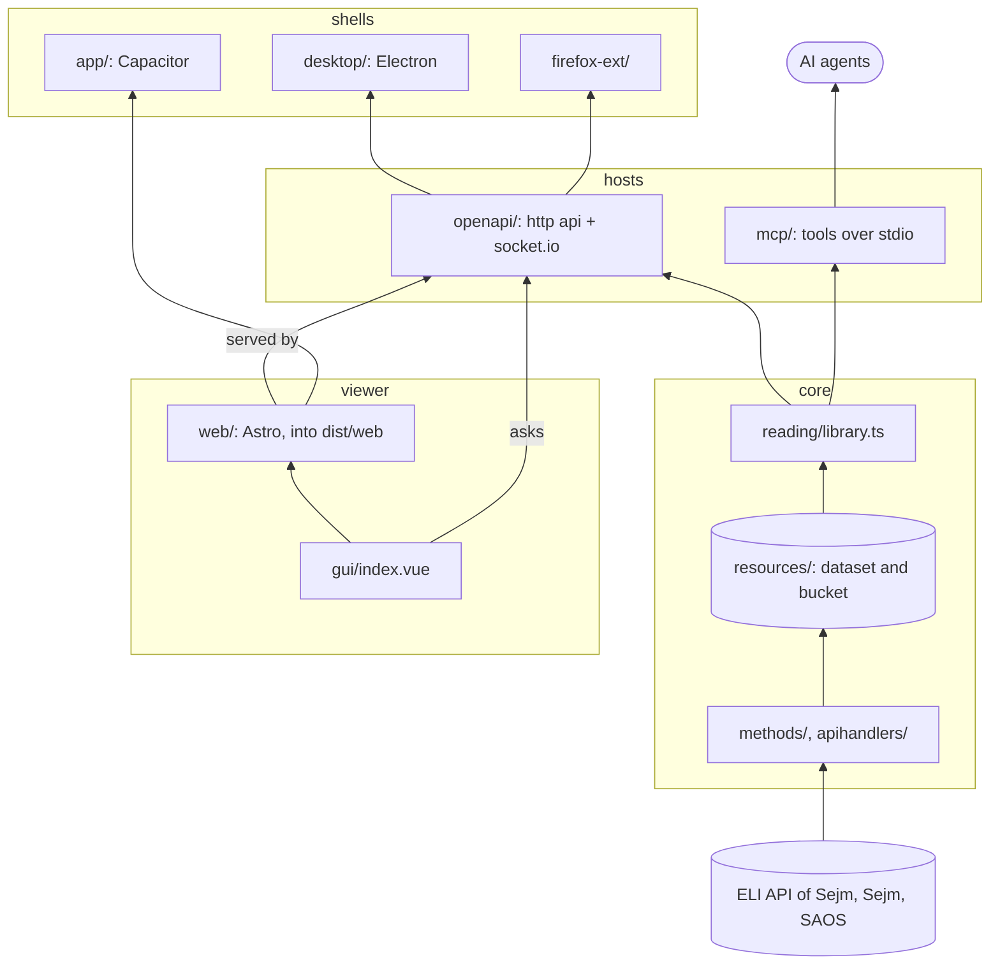
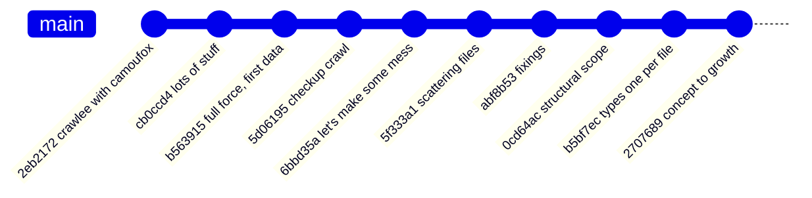

# P_JOL_ROLL - source codes explanations

Everything that runs. One core gathers and reads the journals of laws; every
other directory is a way in to what the core gathered: an api, a server for
AI agents, a website, a window, an android app, a browser extension. None of
them asks the source; only the core does, and only when a person starts it.

## Toys used here

| Toy | For |
| --- | --- |
| [TypeScript](https://www.typescriptlang.org/), run by [tsx](https://tsx.is/) | core, api, MCP server |
| [Crawlee](https://crawlee.dev/) | polite walks over the APIs (`HttpCrawler`) and websites (`PlaywrightCrawler` with Camoufox) |
| [turndown](https://github.com/mixmark-io/turndown) | HTML of acts into markdown |
| [@huggingface/hub](https://huggingface.co/docs/huggingface.js/hub/README) | sync of `resources/` with Hugging Face |
| [Express](https://expressjs.com/) and [socket.io](https://socket.io/) | the http api and its live notices |
| [MCP TypeScript SDK](https://github.com/modelcontextprotocol/typescript-sdk) (`@modelcontextprotocol/server`) and [zod](https://zod.dev/) | tools for AI agents |
| [Vue](https://vuejs.org/) and [marked](https://marked.js.org/) | the viewer, shared by every interface |
| [Astro](https://astro.build/) with `@astrojs/vue` | the website, built into static files |
| [Electron](https://www.electronjs.org/) | the desktop window |
| [Capacitor](https://capacitorjs.com/) | the android app (configured, not set up yet) |
| WebExtensions, manifest v3 | the browser extension, Firefox and Chrome |

## Four major parts

The directories group into four parts. Each part only leans on the one below it.

| Part | Directories | What it is |
| --- | --- | --- |
| **core** | `core/` | gathering, checksums, tables, markdown, and reading of all of it |
| **hosts** | `openapi/`, `mcp/` | serve what the core reads: to programs over http, to AI agents over stdio |
| **viewer** | `gui/`, `web/` | one Vue viewer, and the website that carries it |
| **shells** | `desktop/`, `app/`, `firefox-ext/`, `chrome-ext/` | wrap the viewer or the api for one kind of device |

## How the code grew

All on `master`, each commit written by Sett Sarverott; only the commits
that touched `src/` are shown. `git log --oneline -- src` gives the newest.

## Every file

### core

| File | What, why and where |
| --- | --- |
| `src/core/main.ts` | Command line of the gatherer: reads arguments and calls one command. Usage is written at its top. Run by `task gather`, `seal`, `compile`, `text`, `sejm`, `saos`, `checkup`, `hub`, and by the Docker image. |
| `src/core/crawl.ts` | One polite walk over addresses of an API: own User-Agent, two requests at a time, a pace per minute, queue in memory. Every gatherer uses it, so manners live in one place. |
| `src/core/apihandlers/eli.ts` | Addresses of the ELI API of Sejm and the files of an act (`filesOf`). Where to ask, never what to do. |
| `src/core/apihandlers/sejm.ts` | Second source: legislative processes and prints of Sejm, into `resources/sejm-dataset` and `sejm-bucket`. |
| `src/core/apihandlers/saos.ts` | Third source: court judgments of SAOS by months, into `resources/saos-dataset`. |
| `src/core/methods/gather.ts` | The gatherer: index, lists, listings of years, then files of acts year by year; `--since` takes changed acts again. Writes a checksum record for every file the moment it lands. |
| `src/core/methods/seal.ts` | Checksum records for files gathered without them, and `--check` that reads every file again. |
| `src/core/methods/compile.ts` | Tables of the dataset from raw files: details and references of acts, a year in a file. |
| `src/core/methods/checkup.ts` | Browser (Camoufox) visits websites that show acts to people and writes what it saw. |
| `src/core/parsing/text.ts` | Markdown from the HTML of acts, with a record that ties both by checksums. |
| `src/core/parsing/turndown.d.ts` | Types for turndown, which comes without them. |
| `src/core/resources/store.ts` | Where every gathered thing is written and how: `.part` first, then the real name. |
| `src/core/resources/hub.ts` | Comparison and sync of `resources/` with Hugging Face, file by file. |
| `src/core/reading/library.ts` | Gathered data as readers see it: journals, pages of acts, one act, its text, its ties, its files. Only reads `resources/`. The hosts stand on this and nothing else. |
| `src/core/vars/interfaces/*.interface.ts` | Every interface, one per file. `index.ts` there groups them into `GatheringScope`, `HuggingfaceScope` and `ReadingScope`. |
| `src/core/vars/types/*.type.ts` | Every type alias, one per file, grouped the same way in its `index.ts`. |

### hosts

| File | What, why and where |
| --- | --- |
| `src/openapi/main.ts` | Starts the http api: `task serve`. `PORT` and `HOST` in environment; by default only this machine can reach it. |
| `src/openapi/server.ts` | Express app, socket.io (sends `journals` on connect and `changed` when files of the dataset change), and the built website from `dist/web`. Open to every origin, because the data is public and the extension and the app ask from elsewhere. |
| `src/openapi/routes.ts` | The read-only routes under `/api`. |
| `src/openapi/spec.ts` | OpenAPI 3.1 description, served at `/openapi.json`. Kept by hand next to the routes. |
| `src/mcp/main.ts` | MCP server over stdio: tools `journals`, `search_acts`, `act`, `act_text`, `act_references`. Read-only, so an agent cannot start a crawl of the source. `task mcp`. |

### viewer

| File | What, why and where |
| --- | --- |
| `src/gui/index.vue` | The one viewer: pick a journal and a year, search titles, open an act, read its markdown, follow its ties, open its PDF. Takes the address of the api as `api`. Every interface shows this. |
| `src/web/pages/index.astro` | The website page that carries the viewer. `task web:build` writes `dist/web`, which the api serves. `PUBLIC_API` at build time points it at another host. |
| `astro.config.mjs` (root) | Where Astro finds `src/web` and writes `dist/web`. |

### shells

| File | What, why and where |
| --- | --- |
| `src/desktop/main.js` | Electron window: starts the api for itself on this machine only and shows the viewer. `task desktop`. |
| `src/app/manifest.json` | Web app manifest of the viewer, linked by the website, so it can also be installed from a browser. |
| `src/app/capacitor.config.json` | Capacitor settings of the android app: its web part is `dist/web`. `task app:sync -- add android` the first time. |
| `src/firefox-ext/manifest.json`, `popup.html`, `main.js` | Browser extension: looks up an act cited in the open tab or typed in (`Dz.U. 2026 poz. 1`, ISAP addresses, ELI) in a P_JOL_ROLL host. Loads in Firefox, and unpacked in Chrome. `task extension` says how. |
| `src/chrome-ext/main.js` | Empty, kept by Sett; the Firefox extension loads in Chrome already. |
| `src/Taskfile.yml` | Tasks of these parts, included in the root one: `serve`, `mcp`, `web:build`, `web:dev`, `desktop`, `app:sync`, `extension`. |
